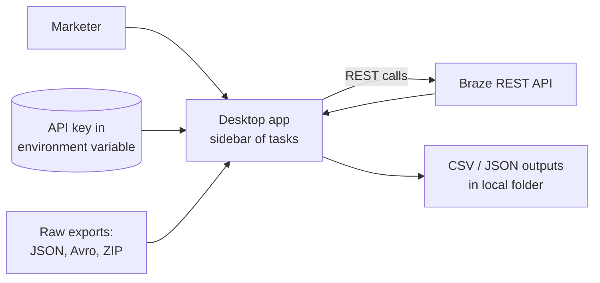
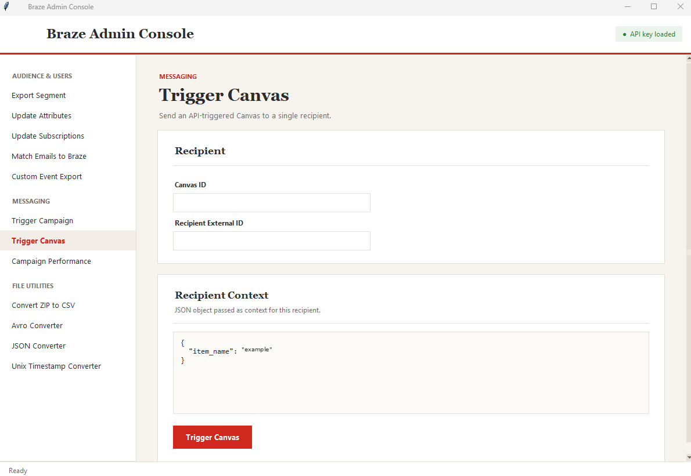

# Braze Admin Console

*Internal desktop tool. Source is private and was built for internal use.*

## Problem
Routine Braze data jobs, like exporting a segment, fixing one user's attributes or subscriptions, sending a test trigger, or converting a raw export file, meant either writing one-off API scripts or filing a dev ticket. That slowed down the marketing team and made simple fixes depend on engineering time.

## What I built
A single desktop app (built with Claude's help) that puts about a dozen Braze API and file tasks behind a clean sidebar UI, grouped into **Audience & Users**, **Messaging**, and **File Utilities**. Teammates can do the work themselves with no code.

## How it works
The app runs locally. It reads the Braze API key from an environment variable (never stored in the tool), sends requests to Braze's documented REST endpoints, and saves results as CSV files in a folder the user picks.

## Key features
**Audience & Users**
- Export a segment with chosen standard and custom fields
- Export custom-event counts by segment over a date range
- Match a CSV of emails to Braze profiles, writing separate "matched" and "missing" files
- Update user attributes and subscription-group status for a single user
- Remove all push tokens from a user, with an optional attribute update

**Messaging**
- Trigger an API-triggered campaign or Canvas for a user, passing optional trigger properties
- Pull campaign performance over a date range

**File Utilities**
- Split large JSON exports into parts and convert them to CSV
- Convert Avro and zipped export files to CSV
- Unix timestamp converter

## Tools and stack
Python · Tkinter · Braze REST API (user export, user track, subscriptions, campaign/Canvas triggers, analytics) · Claude

## Safeguards
- API key comes from an environment variable, and a status indicator shows whether it's loaded
- Required fields are checked before any call goes out, with clear warnings
- Lookups confirm a user exists (and has push tokens) before making changes
- Light throttling on bulk lookups to stay within API rate limits
- Errors are logged and shown to the user instead of failing silently

## Impact
- Routine Braze data tasks became self-serve for me and teammates, with no dev tickets
- Faster troubleshooting of individual user issues
- One consistent, repeatable way to do jobs that used to be one-off scripts

## Screenshots

*Sanitized screenshot: names and values are placeholders.*
