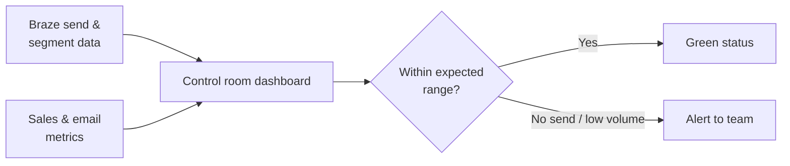
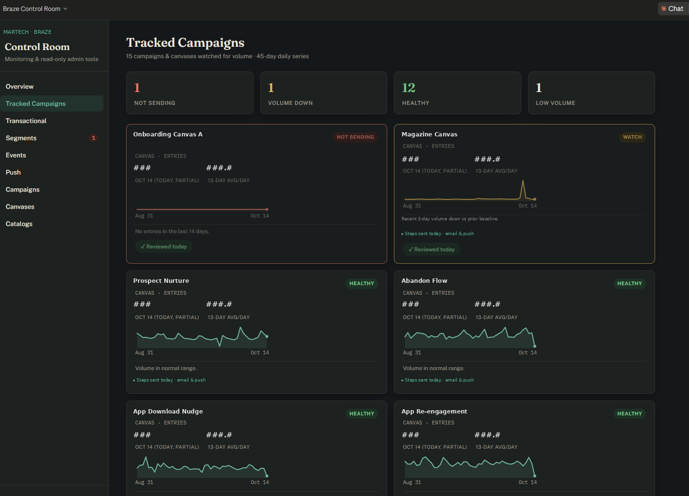

# Braze Control Room

*Internal monitoring dashboard. Source is private and was built for internal use.*

## Problem
Transactional emails and recurring sends can quietly stop firing, and segment sizes can drop without anyone noticing until customers or revenue are affected. Checking each one by hand in the platform every day doesn't scale.

## What I built
A Claude-built "control room" dashboard that monitors transactional sends, segment volumes, and sales and email metrics in one place, with alerts when something isn't firing or volume runs low.

## How it works
The dashboard brings send, segment, and sales data together, compares it to expected activity, and flags anything that drifts outside normal ranges.

## Key features
- Status view of transactional email activity
- Segment volume tracking over time
- Sales and email metrics side by side
- Alerts for sends that stop firing or volumes that run low

## Tools and stack
Claude · Braze REST API · dashboarding

## Safeguards
- Read-only monitoring: it doesn't change data in Braze

## Impact
- Problems surface early instead of after customers notice
- One daily view replaces a series of manual platform checks

## Screenshots

*Sanitized screenshot: names and values are placeholders.*
