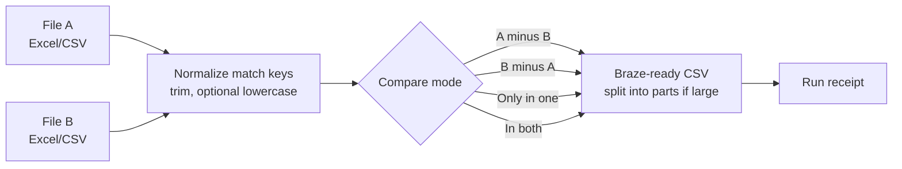

# List Compare

*Internal data utility. Source is private and was built for internal use.*

## Problem
Audience work often means comparing two very large spreadsheets, like a suppression list against a send list or a partner file against the CRM. Excel struggles at that size, and doing it by hand is slow and error-prone.

## What I built
A desktop app that compares two large Excel or CSV files on a chosen match column and exports a Braze-ready CSV, plus a "receipt" documenting exactly what was done.

## How it works
Pick File A and File B (and a sheet for Excel files), choose the match column in each, pick a comparison mode, and choose which extra columns to carry through. Matching runs in the background so the app stays responsive, and the output is written as UTF-8 CSV, split into parts if needed.

## Key features
- Four modes: A not in B, B not in A, in only one file, or in both
- Renames the ID column to a Braze identifier (external_id, email, braze_id, phone) or keeps the original
- Pick which extra columns to keep
- Optional maximum rows per file, to split big outputs into numbered parts
- Uses a fast Excel reader when it's available and falls back automatically when it isn't
- Run receipt with date, files, columns, mode, counts, and duration, which can be copied or saved
- Remembers preferences, and has several layout and theme options

## Tools and stack
Python · pandas · Tkinter · Claude

## Safeguards
- Counts and reports blank match keys instead of silently matching them
- Normalizes keys so case and whitespace don't create false mismatches
- Only loads the columns it needs, keeping memory use down on huge files
- Fully local: no data leaves the machine
- The receipt gives an audit trail for every list pulled

## Impact
- Large list comparisons that used to stall Excel became quick and repeatable
- Outputs are ready to import into Braze without reformatting
- Receipts make it easy to answer "where did this list come from?"

## Screenshots
*Screenshots coming soon.*

<!-- Screenshot placeholders (sanitized, fake data only):
- Main window with two fake files loaded and a mode selected
- Sample receipt with fake file names and counts
-->
