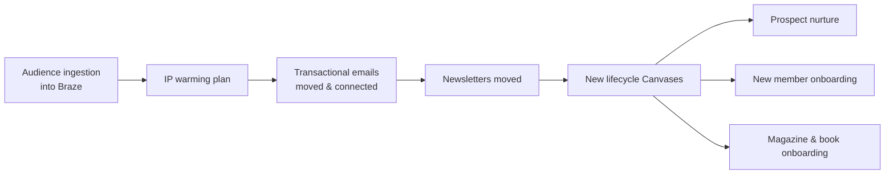

# SFMC → Braze Migration

*Platform migration project. Internal work for a subscription media company.*

## Problem
The company was moving its email and lifecycle program from Salesforce Marketing Cloud to Braze. Every newsletter, transactional email, customer record, and lifecycle campaign had to move without interrupting day-to-day sending.

## What I built
I led the migration end to end. I transferred all newsletters, customer records, and lifecycle campaigns and performed IP warming with no interruption to business as usual, in about a month. Then I built the new lifecycle program in Braze Canvas.

## How it works

## Key features
- Audience ingestion and subscription mapping
- Staged IP warming to protect deliverability
- Rebuilding and reconnecting transactional emails and newsletters (Liquid and HTML)
- New onboarding and nurture journeys in Canvas

## Tools and stack
Braze (Canvas, Liquid, subscription groups) · Salesforce Marketing Cloud (AMPscript) · HTML · SQL

## Safeguards
- Gradual warming instead of a hard cutover

## Impact
- Completed in about a month with no disruption to business as usual
- Gave the team a modern lifecycle foundation, with the onboarding and nurture journeys built on it

## Screenshots
*Screenshots coming soon.*

<!-- Screenshot placeholders (sanitized, fake data only):
- A generic Canvas flow diagram with renamed steps (no real campaign names)
-->
