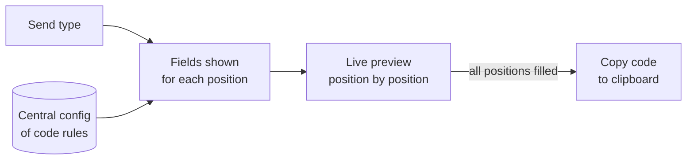

# Tracking Code Builder

*Internal desktop tool. Source is private and was built for internal use.*

## Problem
Every email and push send carries a short, fixed-length tracking code where each character position means something (channel, program, year, month, send number, test version, segment). Building these by hand from a key sheet led to typos and inconsistent reporting.

## What I built
A small guided builder: pick the type of send, and the app shows exactly the fields needed to fill each position of the code, then copies the finished code to the clipboard.

## How it works
Code rules live in one config section, so updating the key sheet means editing values in one place, not rewriting the app. Choosing a send type (scheduled email, journey email, editorial push, journey push, and others) changes the fields shown, and some choices open extra sub-fields.

## Key features
- Dropdowns for coded values and validated text entry for free-form positions
- Year options roll forward automatically, and month and send-number letters are generated
- Live preview shows which positions are filled and which are still blank
- One-click copy when the code is complete

## Tools and stack
Python (standard library only) · Tkinter · Claude

## Safeguards
- Won't produce a code until every position is filled
- Input is restricted to valid characters and lengths
- All code rules live in one central config, so they stay in step with the official key sheet

## Impact
- Consistent tracking codes across email and push, which makes reporting cleaner
- Fewer manual errors, and faster setup for each send

## Screenshots
*Screenshots coming soon.*

<!-- Screenshot placeholders (sanitized, fake data only):
- Builder with a send type picked and a made-up example code in the preview
-->
